# Cambodian Multi-Tenant SaaS Invoicing & Accounting System
## System Architecture & Phased Implementation Plan

---

## 1. Executive Architecture Overview

### 1.1 Stack & Component Layout
* **Backend**: NestJS 12 (TypeScript, Modular Monolith) located in `backend/`
* **Frontend**: Nuxt 4 (Vue 3, TypeScript, TailwindCSS v4, DaisyUI v5) located in root / `src/`
* **Database**: PostgreSQL with Row-Level Security (RLS)
* **ORM**: TypeORM with custom tenant-aware repositories and query runner transactions

```
backend/src/
├── common/                     # Cross-cutting infrastructure
│   ├── context/                # TenantContext via AsyncLocalStorage
│   ├── database/               # BaseTenantEntity, BaseTenantRepository
│   ├── decorators/             # @CurrentTenant(), @CurrentUser(), @Roles()
│   ├── guards/                 # JwtAuthGuard, TenantGuard, RolesGuard
│   ├── interceptors/           # AuditLogInterceptor, TenantRlsInterceptor
│   └── utils/                  # Decimal.js money math, NBC exchange calculations
├── config/                     # typeorm.config, jwt.config, app.config
├── database/                   # migrations/, seeds/
└── modules/
    ├── auth/                   # Authentication (JWT, Refresh, Register)
    ├── tenants/                # Tenant lifecycle, settings, memberships
    ├── users/                  # User accounts and credentials
    ├── tracking/               # Phase 1: Simple money in/out tracker
    ├── contacts/               # Phase 2: Customers, suppliers
    ├── products/               # Phase 2: Products, services, price lists
    ├── taxes/                  # Phase 2: Cambodian tax rates (VAT 10%, 0%, WHT)
    ├── sequences/              # Phase 2: Pessimistic-locked gapless sequence generator
    ├── invoices/               # Phase 2: Invoices, items, KHQR generator, PDF renderer
    ├── payments/               # Phase 2: Payments, partial allocations
    ├── accounting/             # Phase 3: Chart of accounts, journal entries, ledger poster
    ├── reports/                # Phase 3: P&L, Balance Sheet, Cash Flow, Aging, VAT
    ├── subscriptions/          # Phase 4: SaaS subscription plans and usage limits
    ├── audit/                  # Phase 4: Immutable audit logs
    └── einvoice/               # Phase 4: CamInvoice UBL 2.1 XML pipeline
```

### 1.2 Multi-Tenancy Strategy (Two-Layer Defense)
1. **Application Layer (NestJS Context)**:
   * Requests carry JWT containing `tenant_id` or an `X-Tenant-Id` header (validated against tenant memberships).
   * Stored in Node.js `AsyncLocalStorage` via `TenantContextService`.
   * Base repository automatically injects `where: { tenant_id: currentTenantId }` and assigns `entity.tenant_id = currentTenantId` on writes.
2. **Database Layer (PostgreSQL Row-Level Security - RLS)**:
   * Every transaction sets session variable: `SET LOCAL app.current_tenant_id = '<uuid>';`
   * Every tenant table has:
     ```sql
     ALTER TABLE <table_name> ENABLE ROW LEVEL SECURITY;
     CREATE POLICY tenant_isolation_policy ON <table_name>
       USING (tenant_id = NULLIF(current_setting('app.current_tenant_id', true), '')::uuid)
       WITH CHECK (tenant_id = NULLIF(current_setting('app.current_tenant_id', true), '')::uuid);
     ```

### 1.3 Precision Money Handling in Dual-Currency Cambodia
* **Decision**: `NUMERIC(18, 2)` for amounts, `NUMERIC(18, 4)` for unit prices, `NUMERIC(18, 6)` for exchange rates. Handled via `Decimal.js` in Node.
* **Reasoning**: In Cambodia, USD uses 2 decimal places ($10.50) while KHR (Cambodian Riel) has no minor units (៛41,000). Integer minor units (cents) cause rounding errors during exchange conversions (e.g. 1 USD = 4,085 KHR) and fractional line item rates. PostgreSQL `NUMERIC` avoids IEEE-754 binary floating-point drift.
* Every money record explicitly stores `amount`, `currency` ('USD' | 'KHR'), `exchange_rate`, and `base_amount`.

### 1.4 Sequential Invoice Numbering under Concurrency
* Uses row-level pessimistic locking (`SELECT ... FOR UPDATE`) on the `number_sequences` table.
* Numbers are only assigned when transitioning from `DRAFT` to `ISSUED` / `POSTED`.
* Ensures zero gaps and zero duplicate invoice numbers even under concurrent worker requests.

### 1.5 Ledger Balancing Guarantee
* In code: `JournalEntryService` validates `|sum(debits) - sum(credits)| < 0.0001`.
* In database: 
  * Header table check: `CHECK (total_debit = total_credit)`.
  * Deferred constraint trigger on `journal_lines` that runs on `COMMIT`:
    ```sql
    CREATE CONSTRAINT TRIGGER trg_verify_journal_balance
    AFTER INSERT OR UPDATE OR DELETE ON journal_lines
    DEFERRABLE INITIALLY DEFERRED
    FOR EACH ROW EXECUTE FUNCTION verify_journal_balanced();
    ```

---

## 2. Complete Entity-Relationship Diagram (ERD)

```mermaid
erDiagram
    tenants ||--o{ tenant_users : has
    users ||--o{ tenant_users : belongs_to
    tenants ||--o{ currencies : configures
    tenants ||--o{ exchange_rates : tracks
    tenants ||--o{ tax_rates : configures
    tenants ||--o{ categories : categorizes
    tenants ||--o{ customers : trades_with
    tenants ||--o{ suppliers : purchases_from
    tenants ||--o{ products : sells
    tenants ||--o{ number_sequences : maintains
    tenants ||--o{ invoices : issues
    tenants ||--o{ expenses : records
    tenants ||--o{ payments : transacts
    tenants ||--o{ accounts : owns
    tenants ||--o{ journal_entries : posts
    tenants ||--o{ audit_logs : logs
    tenants ||--o{ subscriptions : subscribes

    invoices ||--o{ invoice_items : contains
    invoices ||--o{ payment_allocations : settled_by
    invoices ||--o{ einvoice_submissions : submits
    
    expenses ||--o{ expense_items : contains
    expenses ||--o{ payment_allocations : settled_by

    payments ||--o{ payment_allocations : allocates

    accounts ||--o{ journal_lines : classified_in
    journal_entries ||--o{ journal_lines : comprises

    tenants {
        uuid id PK
        varchar name
        varchar tax_id
        varchar base_currency
        jsonb settings
        timestamp created_at
        timestamp updated_at
    }

    users {
        uuid id PK
        varchar email UK
        varchar password_hash
        varchar full_name
        varchar phone
        boolean is_active
        timestamp created_at
    }

    tenant_users {
        uuid id PK
        uuid tenant_id FK
        uuid user_id FK
        varchar role
        jsonb permissions
    }

    tax_rates {
        uuid id PK
        uuid tenant_id FK
        varchar name
        numeric rate
        varchar code
        boolean is_active
    }

    customers {
        uuid id PK
        uuid tenant_id FK
        varchar name
        varchar vat_number
        varchar contact_phone
        varchar address
    }

    suppliers {
        uuid id PK
        uuid tenant_id FK
        varchar name
        varchar vat_number
        varchar contact_phone
    }

    products {
        uuid id PK
        uuid tenant_id FK
        varchar code
        varchar name
        varchar name_kh
        numeric unit_price
        varchar currency
        uuid tax_rate_id FK
    }

    invoices {
        uuid id PK
        uuid tenant_id FK
        uuid customer_id FK
        varchar invoice_number
        varchar status
        date issue_date
        date due_date
        varchar currency
        numeric exchange_rate
        numeric subtotal
        numeric tax_total
        numeric total_amount
        numeric paid_amount
        numeric balance_due
        varchar qr_payload
    }

    invoice_items {
        uuid id PK
        uuid invoice_id FK
        uuid product_id FK
        text description
        numeric quantity
        numeric unit_price
        numeric discount_rate
        numeric tax_amount
        numeric total_amount
    }

    payments {
        uuid id PK
        uuid tenant_id FK
        varchar payment_type
        varchar payment_method
        varchar reference_number
        date payment_date
        numeric amount
        varchar currency
        numeric exchange_rate
    }

    payment_allocations {
        uuid id PK
        uuid payment_id FK
        uuid invoice_id FK
        uuid expense_id FK
        numeric allocated_amount
    }

    expenses {
        uuid id PK
        uuid tenant_id FK
        uuid supplier_id FK
        varchar expense_number
        varchar status
        date expense_date
        numeric total_amount
        varchar currency
    }

    accounts {
        uuid id PK
        uuid tenant_id FK
        varchar code
        varchar name
        varchar type
        boolean is_active
    }

    journal_entries {
        uuid id PK
        uuid tenant_id FK
        varchar entry_number
        date entry_date
        varchar source_type
        uuid source_id
        numeric total_debit
        numeric total_credit
        boolean is_posted
    }

    journal_lines {
        uuid id PK
        uuid journal_entry_id FK
        uuid account_id FK
        numeric debit
        numeric credit
        text memo
    }

    einvoice_submissions {
        uuid id PK
        uuid invoice_id FK
        varchar status
        text ubl_xml
        text qr_data
        jsonb gdt_response
    }
```



---

## 3. Database Schema per Phase

### Phase 1: Foundation & Simple Money Tracker

```sql
-- 1. tenants
CREATE TABLE tenants (
    id UUID PRIMARY KEY DEFAULT gen_random_uuid(),
    name VARCHAR(255) NOT NULL,
    legal_name_kh VARCHAR(255) NULL,
    tax_id VARCHAR(50) NULL, -- Cambodian VATTIN
    base_currency VARCHAR(3) NOT NULL DEFAULT 'USD',
    timezone VARCHAR(50) NOT NULL DEFAULT 'Asia/Phnom_Penh',
    phone VARCHAR(50) NULL,
    address TEXT NULL,
    settings JSONB NOT NULL DEFAULT '{}',
    is_active BOOLEAN NOT NULL DEFAULT true,
    created_at TIMESTAMPTZ NOT NULL DEFAULT now(),
    updated_at TIMESTAMPTZ NOT NULL DEFAULT now(),
    CONSTRAINT chk_tenants_base_currency CHECK (base_currency IN ('USD', 'KHR'))
);

-- 2. users
CREATE TABLE users (
    id UUID PRIMARY KEY DEFAULT gen_random_uuid(),
    email VARCHAR(255) NOT NULL UNIQUE,
    password_hash VARCHAR(255) NOT NULL,
    full_name VARCHAR(255) NOT NULL,
    phone VARCHAR(50) NULL,
    is_active BOOLEAN NOT NULL DEFAULT true,
    created_at TIMESTAMPTZ NOT NULL DEFAULT now(),
    updated_at TIMESTAMPTZ NOT NULL DEFAULT now()
);
CREATE INDEX idx_users_email ON users(email);

-- 3. tenant_users (Role-Based Membership)
CREATE TABLE tenant_users (
    id UUID PRIMARY KEY DEFAULT gen_random_uuid(),
    tenant_id UUID NOT NULL REFERENCES tenants(id) ON DELETE CASCADE,
    user_id UUID NOT NULL REFERENCES users(id) ON DELETE CASCADE,
    role VARCHAR(50) NOT NULL DEFAULT 'STAFF',
    permissions JSONB NOT NULL DEFAULT '[]',
    created_at TIMESTAMPTZ NOT NULL DEFAULT now(),
    updated_at TIMESTAMPTZ NOT NULL DEFAULT now(),
    CONSTRAINT chk_tenant_users_role CHECK (role IN ('OWNER', 'ADMIN', 'ACCOUNTANT', 'STAFF')),
    CONSTRAINT uq_tenant_users UNIQUE (tenant_id, user_id)
);
CREATE INDEX idx_tenant_users_lookup ON tenant_users(tenant_id, user_id);

-- 4. currencies
CREATE TABLE currencies (
    code VARCHAR(3) PRIMARY KEY,
    name VARCHAR(50) NOT NULL,
    symbol VARCHAR(10) NOT NULL,
    decimal_places INT NOT NULL DEFAULT 2
);

-- 5. exchange_rates
CREATE TABLE exchange_rates (
    id UUID PRIMARY KEY DEFAULT gen_random_uuid(),
    tenant_id UUID NOT NULL REFERENCES tenants(id) ON DELETE CASCADE,
    from_currency VARCHAR(3) NOT NULL REFERENCES currencies(code),
    to_currency VARCHAR(3) NOT NULL REFERENCES currencies(code),
    rate NUMERIC(18, 6) NOT NULL,
    effective_date DATE NOT NULL,
    source VARCHAR(50) NOT NULL DEFAULT 'MANUAL', -- 'NBC' (National Bank of Cambodia) or 'MANUAL'
    created_at TIMESTAMPTZ NOT NULL DEFAULT now(),
    CONSTRAINT chk_rate_positive CHECK (rate > 0),
    CONSTRAINT uq_tenant_exchange_rate UNIQUE (tenant_id, from_currency, to_currency, effective_date)
);

-- 6. categories
CREATE TABLE categories (
    id UUID PRIMARY KEY DEFAULT gen_random_uuid(),
    tenant_id UUID NOT NULL REFERENCES tenants(id) ON DELETE CASCADE,
    name VARCHAR(100) NOT NULL,
    type VARCHAR(20) NOT NULL,
    color VARCHAR(20) NULL,
    parent_id UUID NULL REFERENCES categories(id) ON DELETE SET NULL,
    is_active BOOLEAN NOT NULL DEFAULT true,
    created_at TIMESTAMPTZ NOT NULL DEFAULT now(),
    updated_at TIMESTAMPTZ NOT NULL DEFAULT now(),
    CONSTRAINT chk_category_type CHECK (type IN ('INCOME', 'EXPENSE')),
    CONSTRAINT uq_tenant_category_name UNIQUE (tenant_id, type, name)
);

-- 7. income_records (Simple Tracker)
CREATE TABLE income_records (
    id UUID PRIMARY KEY DEFAULT gen_random_uuid(),
    tenant_id UUID NOT NULL REFERENCES tenants(id) ON DELETE CASCADE,
    category_id UUID NULL REFERENCES categories(id) ON DELETE SET NULL,
    amount NUMERIC(18, 2) NOT NULL,
    currency VARCHAR(3) NOT NULL REFERENCES currencies(code),
    exchange_rate NUMERIC(18, 6) NOT NULL DEFAULT 1.000000,
    base_amount NUMERIC(18, 2) NOT NULL,
    received_date DATE NOT NULL,
    payment_method VARCHAR(50) NOT NULL DEFAULT 'CASH',
    reference_number VARCHAR(100) NULL,
    description TEXT NULL,
    created_by UUID NOT NULL REFERENCES users(id),
    is_void BOOLEAN NOT NULL DEFAULT false,
    void_reason TEXT NULL,
    created_at TIMESTAMPTZ NOT NULL DEFAULT now(),
    updated_at TIMESTAMPTZ NOT NULL DEFAULT now(),
    CONSTRAINT chk_income_amount_pos CHECK (amount > 0),
    CONSTRAINT chk_income_method CHECK (payment_method IN ('CASH', 'BAKONG', 'BANK_TRANSFER', 'CHEQUE'))
);
CREATE INDEX idx_income_tenant_date ON income_records(tenant_id, received_date);

-- 8. expense_records (Simple Tracker)
CREATE TABLE expense_records (
    id UUID PRIMARY KEY DEFAULT gen_random_uuid(),
    tenant_id UUID NOT NULL REFERENCES tenants(id) ON DELETE CASCADE,
    category_id UUID NULL REFERENCES categories(id) ON DELETE SET NULL,
    amount NUMERIC(18, 2) NOT NULL,
    currency VARCHAR(3) NOT NULL REFERENCES currencies(code),
    exchange_rate NUMERIC(18, 6) NOT NULL DEFAULT 1.000000,
    base_amount NUMERIC(18, 2) NOT NULL,
    expense_date DATE NOT NULL,
    payment_method VARCHAR(50) NOT NULL DEFAULT 'CASH',
    vendor_name VARCHAR(255) NULL,
    reference_number VARCHAR(100) NULL,
    description TEXT NULL,
    created_by UUID NOT NULL REFERENCES users(id),
    is_void BOOLEAN NOT NULL DEFAULT false,
    void_reason TEXT NULL,
    created_at TIMESTAMPTZ NOT NULL DEFAULT now(),
    updated_at TIMESTAMPTZ NOT NULL DEFAULT now(),
    CONSTRAINT chk_expense_amount_pos CHECK (amount > 0),
    CONSTRAINT chk_expense_method CHECK (payment_method IN ('CASH', 'BAKONG', 'BANK_TRANSFER', 'CHEQUE'))
);
CREATE INDEX idx_expense_tenant_date ON expense_records(tenant_id, expense_date);

-- 9. attachments
CREATE TABLE attachments (
    id UUID PRIMARY KEY DEFAULT gen_random_uuid(),
    tenant_id UUID NOT NULL REFERENCES tenants(id) ON DELETE CASCADE,
    attachable_type VARCHAR(50) NOT NULL,
    attachable_id UUID NOT NULL,
    file_name VARCHAR(255) NOT NULL,
    file_url TEXT NOT NULL,
    file_size INT NOT NULL,
    mime_type VARCHAR(100) NOT NULL,
    created_by UUID NOT NULL REFERENCES users(id),
    created_at TIMESTAMPTZ NOT NULL DEFAULT now()
);
CREATE INDEX idx_attachments_lookup ON attachments(tenant_id, attachable_type, attachable_id);
```

---

### Phase 2: Contacts, Products, Taxes, Invoices & Payments

```sql
-- 10. tax_rates
CREATE TABLE tax_rates (
    id UUID PRIMARY KEY DEFAULT gen_random_uuid(),
    tenant_id UUID NOT NULL REFERENCES tenants(id) ON DELETE CASCADE,
    name VARCHAR(100) NOT NULL,
    code VARCHAR(50) NOT NULL,
    rate NUMERIC(5, 4) NOT NULL,
    is_compound BOOLEAN NOT NULL DEFAULT false,
    is_active BOOLEAN NOT NULL DEFAULT true,
    created_at TIMESTAMPTZ NOT NULL DEFAULT now(),
    CONSTRAINT chk_tax_rate_bounds CHECK (rate >= 0 AND rate <= 1),
    CONSTRAINT uq_tenant_tax_rate_code UNIQUE (tenant_id, code)
);

-- 11. customers
CREATE TABLE customers (
    id UUID PRIMARY KEY DEFAULT gen_random_uuid(),
    tenant_id UUID NOT NULL REFERENCES tenants(id) ON DELETE CASCADE,
    name VARCHAR(255) NOT NULL,
    name_kh VARCHAR(255) NULL,
    vat_number VARCHAR(50) NULL,
    contact_person VARCHAR(100) NULL,
    email VARCHAR(255) NULL,
    phone VARCHAR(50) NULL,
    address TEXT NULL,
    credit_limit NUMERIC(18, 2) NOT NULL DEFAULT 0.00,
    payment_terms_days INT NOT NULL DEFAULT 30,
    is_active BOOLEAN NOT NULL DEFAULT true,
    deleted_at TIMESTAMPTZ NULL,
    created_at TIMESTAMPTZ NOT NULL DEFAULT now(),
    updated_at TIMESTAMPTZ NOT NULL DEFAULT now()
);
CREATE INDEX idx_customers_tenant_name ON customers(tenant_id, name) WHERE deleted_at IS NULL;

-- 12. suppliers
CREATE TABLE suppliers (
    id UUID PRIMARY KEY DEFAULT gen_random_uuid(),
    tenant_id UUID NOT NULL REFERENCES tenants(id) ON DELETE CASCADE,
    name VARCHAR(255) NOT NULL,
    name_kh VARCHAR(255) NULL,
    vat_number VARCHAR(50) NULL,
    contact_person VARCHAR(100) NULL,
    email VARCHAR(255) NULL,
    phone VARCHAR(50) NULL,
    address TEXT NULL,
    is_active BOOLEAN NOT NULL DEFAULT true,
    deleted_at TIMESTAMPTZ NULL,
    created_at TIMESTAMPTZ NOT NULL DEFAULT now(),
    updated_at TIMESTAMPTZ NOT NULL DEFAULT now()
);

-- 13. products
CREATE TABLE products (
    id UUID PRIMARY KEY DEFAULT gen_random_uuid(),
    tenant_id UUID NOT NULL REFERENCES tenants(id) ON DELETE CASCADE,
    category_id UUID NULL REFERENCES categories(id) ON DELETE SET NULL,
    sku VARCHAR(100) NULL,
    name VARCHAR(255) NOT NULL,
    name_kh VARCHAR(255) NULL,
    description TEXT NULL,
    type VARCHAR(20) NOT NULL DEFAULT 'SERVICE',
    unit VARCHAR(20) NOT NULL DEFAULT 'UNIT',
    unit_price NUMERIC(18, 4) NOT NULL DEFAULT 0.0000,
    cost_price NUMERIC(18, 4) NOT NULL DEFAULT 0.0000,
    currency VARCHAR(3) NOT NULL REFERENCES currencies(code),
    tax_rate_id UUID NULL REFERENCES tax_rates(id) ON DELETE SET NULL,
    is_active BOOLEAN NOT NULL DEFAULT true,
    deleted_at TIMESTAMPTZ NULL,
    created_at TIMESTAMPTZ NOT NULL DEFAULT now(),
    updated_at TIMESTAMPTZ NOT NULL DEFAULT now(),
    CONSTRAINT chk_product_type CHECK (type IN ('PRODUCT', 'SERVICE')),
    CONSTRAINT chk_product_unit_price CHECK (unit_price >= 0)
);
CREATE UNIQUE INDEX uq_products_sku ON products(tenant_id, sku) WHERE (sku IS NOT NULL AND deleted_at IS NULL);

-- 14. number_sequences (Gapless Sequential Numbering)
CREATE TABLE number_sequences (
    id UUID PRIMARY KEY DEFAULT gen_random_uuid(),
    tenant_id UUID NOT NULL REFERENCES tenants(id) ON DELETE CASCADE,
    sequence_type VARCHAR(50) NOT NULL, -- 'INVOICE', 'EXPENSE', 'PAYMENT'
    prefix VARCHAR(20) NOT NULL DEFAULT 'INV-',
    fiscal_year INT NOT NULL,
    current_value INT NOT NULL DEFAULT 0,
    padding INT NOT NULL DEFAULT 5,
    created_at TIMESTAMPTZ NOT NULL DEFAULT now(),
    updated_at TIMESTAMPTZ NOT NULL DEFAULT now(),
    CONSTRAINT uq_tenant_sequence UNIQUE (tenant_id, sequence_type, fiscal_year)
);

-- 15. invoices
CREATE TABLE invoices (
    id UUID PRIMARY KEY DEFAULT gen_random_uuid(),
    tenant_id UUID NOT NULL REFERENCES tenants(id) ON DELETE CASCADE,
    customer_id UUID NOT NULL REFERENCES customers(id),
    invoice_number VARCHAR(50) NOT NULL,
    reference_number VARCHAR(100) NULL,
    issue_date DATE NOT NULL,
    due_date DATE NOT NULL,
    status VARCHAR(20) NOT NULL DEFAULT 'DRAFT',
    currency VARCHAR(3) NOT NULL REFERENCES currencies(code),
    exchange_rate NUMERIC(18, 6) NOT NULL DEFAULT 1.000000,
    subtotal NUMERIC(18, 2) NOT NULL DEFAULT 0.00,
    discount_total NUMERIC(18, 2) NOT NULL DEFAULT 0.00,
    tax_total NUMERIC(18, 2) NOT NULL DEFAULT 0.00,
    total_amount NUMERIC(18, 2) NOT NULL DEFAULT 0.00,
    base_total_amount NUMERIC(18, 2) NOT NULL DEFAULT 0.00,
    paid_amount NUMERIC(18, 2) NOT NULL DEFAULT 0.00,
    balance_due NUMERIC(18, 2) NOT NULL DEFAULT 0.00,
    notes TEXT NULL,
    terms TEXT NULL,
    qr_payload TEXT NULL,
    voided_at TIMESTAMPTZ NULL,
    void_reason TEXT NULL,
    created_by UUID NOT NULL REFERENCES users(id),
    created_at TIMESTAMPTZ NOT NULL DEFAULT now(),
    updated_at TIMESTAMPTZ NOT NULL DEFAULT now(),
    CONSTRAINT chk_invoice_dates CHECK (due_date >= issue_date),
    CONSTRAINT chk_invoice_status CHECK (status IN ('DRAFT', 'ISSUED', 'PARTIALLY_PAID', 'PAID', 'OVERDUE', 'VOID')),
    CONSTRAINT uq_tenant_invoice_number UNIQUE (tenant_id, invoice_number)
);
CREATE INDEX idx_invoices_status_due ON invoices(tenant_id, status, due_date);

-- 16. invoice_items
CREATE TABLE invoice_items (
    id UUID PRIMARY KEY DEFAULT gen_random_uuid(),
    invoice_id UUID NOT NULL REFERENCES invoices(id) ON DELETE CASCADE,
    product_id UUID NULL REFERENCES products(id) ON DELETE SET NULL,
    tax_rate_id UUID NULL REFERENCES tax_rates(id) ON DELETE SET NULL,
    description TEXT NOT NULL,
    quantity NUMERIC(18, 4) NOT NULL,
    unit_price NUMERIC(18, 4) NOT NULL,
    discount_rate NUMERIC(5, 4) NOT NULL DEFAULT 0.0000,
    discount_amount NUMERIC(18, 2) NOT NULL DEFAULT 0.00,
    tax_amount NUMERIC(18, 2) NOT NULL DEFAULT 0.00,
    line_total NUMERIC(18, 2) NOT NULL,
    sort_order INT NOT NULL DEFAULT 0,
    CONSTRAINT chk_item_quantity CHECK (quantity > 0),
    CONSTRAINT chk_item_price CHECK (unit_price >= 0),
    CONSTRAINT chk_item_discount CHECK (discount_rate >= 0 AND discount_rate <= 1)
);
CREATE INDEX idx_invoice_items_invoice ON invoice_items(invoice_id);

-- 17. expenses (Vendor Bills)
CREATE TABLE expenses (
    id UUID PRIMARY KEY DEFAULT gen_random_uuid(),
    tenant_id UUID NOT NULL REFERENCES tenants(id) ON DELETE CASCADE,
    supplier_id UUID NULL REFERENCES suppliers(id),
    expense_number VARCHAR(50) NOT NULL,
    vendor_invoice_no VARCHAR(100) NULL,
    issue_date DATE NOT NULL,
    due_date DATE NOT NULL,
    status VARCHAR(20) NOT NULL DEFAULT 'DRAFT',
    currency VARCHAR(3) NOT NULL REFERENCES currencies(code),
    exchange_rate NUMERIC(18, 6) NOT NULL DEFAULT 1.000000,
    subtotal NUMERIC(18, 2) NOT NULL DEFAULT 0.00,
    tax_total NUMERIC(18, 2) NOT NULL DEFAULT 0.00,
    total_amount NUMERIC(18, 2) NOT NULL DEFAULT 0.00,
    paid_amount NUMERIC(18, 2) NOT NULL DEFAULT 0.00,
    balance_due NUMERIC(18, 2) NOT NULL DEFAULT 0.00,
    created_by UUID NOT NULL REFERENCES users(id),
    created_at TIMESTAMPTZ NOT NULL DEFAULT now(),
    updated_at TIMESTAMPTZ NOT NULL DEFAULT now(),
    CONSTRAINT chk_expense_status CHECK (status IN ('DRAFT', 'APPROVED', 'PARTIALLY_PAID', 'PAID', 'VOID')),
    CONSTRAINT uq_tenant_expense_number UNIQUE (tenant_id, expense_number)
);

-- 18. expense_items
CREATE TABLE expense_items (
    id UUID PRIMARY KEY DEFAULT gen_random_uuid(),
    expense_id UUID NOT NULL REFERENCES expenses(id) ON DELETE CASCADE,
    category_id UUID NULL REFERENCES categories(id),
    tax_rate_id UUID NULL REFERENCES tax_rates(id),
    description TEXT NOT NULL,
    quantity NUMERIC(18, 4) NOT NULL DEFAULT 1.0000,
    unit_price NUMERIC(18, 4) NOT NULL,
    tax_amount NUMERIC(18, 2) NOT NULL DEFAULT 0.00,
    line_total NUMERIC(18, 2) NOT NULL
);

-- 19. payments
CREATE TABLE payments (
    id UUID PRIMARY KEY DEFAULT gen_random_uuid(),
    tenant_id UUID NOT NULL REFERENCES tenants(id) ON DELETE CASCADE,
    payment_number VARCHAR(50) NOT NULL,
    payment_type VARCHAR(20) NOT NULL,
    customer_id UUID NULL REFERENCES customers(id),
    supplier_id UUID NULL REFERENCES suppliers(id),
    payment_method VARCHAR(50) NOT NULL,
    payment_date DATE NOT NULL,
    currency VARCHAR(3) NOT NULL REFERENCES currencies(code),
    exchange_rate NUMERIC(18, 6) NOT NULL DEFAULT 1.000000,
    amount NUMERIC(18, 2) NOT NULL,
    base_amount NUMERIC(18, 2) NOT NULL,
    reference_number VARCHAR(100) NULL,
    notes TEXT NULL,
    is_void BOOLEAN NOT NULL DEFAULT false,
    created_by UUID NOT NULL REFERENCES users(id),
    created_at TIMESTAMPTZ NOT NULL DEFAULT now(),
    updated_at TIMESTAMPTZ NOT NULL DEFAULT now(),
    CONSTRAINT chk_payment_type CHECK (payment_type IN ('RECEIPT', 'DISBURSEMENT')),
    CONSTRAINT chk_payment_method CHECK (payment_method IN ('CASH', 'BAKONG', 'BANK_TRANSFER', 'CHEQUE')),
    CONSTRAINT chk_payment_amount CHECK (amount > 0),
    CONSTRAINT uq_tenant_payment_number UNIQUE (tenant_id, payment_number)
);

-- 20. payment_allocations
CREATE TABLE payment_allocations (
    id UUID PRIMARY KEY DEFAULT gen_random_uuid(),
    payment_id UUID NOT NULL REFERENCES payments(id) ON DELETE CASCADE,
    invoice_id UUID NULL REFERENCES invoices(id),
    expense_id UUID NULL REFERENCES expenses(id),
    allocated_amount NUMERIC(18, 2) NOT NULL,
    created_at TIMESTAMPTZ NOT NULL DEFAULT now(),
    CONSTRAINT chk_alloc_amount CHECK (allocated_amount > 0),
    CONSTRAINT chk_alloc_target CHECK (
        (invoice_id IS NOT NULL AND expense_id IS NULL) OR 
        (invoice_id IS NULL AND expense_id IS NOT NULL)
    )
);
```

---

### Phase 3: Chart of Accounts & General Ledger

```sql
-- 21. accounts (Chart of Accounts)
CREATE TABLE accounts (
    id UUID PRIMARY KEY DEFAULT gen_random_uuid(),
    tenant_id UUID NOT NULL REFERENCES tenants(id) ON DELETE CASCADE,
    code VARCHAR(20) NOT NULL,
    name VARCHAR(150) NOT NULL,
    name_kh VARCHAR(150) NULL,
    type VARCHAR(20) NOT NULL,
    subtype VARCHAR(50) NOT NULL,
    currency VARCHAR(3) NULL REFERENCES currencies(code),
    parent_id UUID NULL REFERENCES accounts(id),
    is_reconciled BOOLEAN NOT NULL DEFAULT false,
    is_system BOOLEAN NOT NULL DEFAULT false,
    is_active BOOLEAN NOT NULL DEFAULT true,
    created_at TIMESTAMPTZ NOT NULL DEFAULT now(),
    updated_at TIMESTAMPTZ NOT NULL DEFAULT now(),
    CONSTRAINT chk_account_type CHECK (type IN ('ASSET', 'LIABILITY', 'EQUITY', 'REVENUE', 'EXPENSE')),
    CONSTRAINT uq_tenant_account_code UNIQUE (tenant_id, code)
);

-- 22. journal_entries
CREATE TABLE journal_entries (
    id UUID PRIMARY KEY DEFAULT gen_random_uuid(),
    tenant_id UUID NOT NULL REFERENCES tenants(id) ON DELETE CASCADE,
    entry_number VARCHAR(50) NOT NULL,
    entry_date DATE NOT NULL,
    source_type VARCHAR(50) NOT NULL,
    source_id UUID NULL,
    reference_number VARCHAR(100) NULL,
    memo TEXT NULL,
    total_debit NUMERIC(18, 2) NOT NULL,
    total_credit NUMERIC(18, 2) NOT NULL,
    is_posted BOOLEAN NOT NULL DEFAULT true,
    posted_at TIMESTAMPTZ NOT NULL DEFAULT now(),
    created_by UUID NOT NULL REFERENCES users(id),
    created_at TIMESTAMPTZ NOT NULL DEFAULT now(),
    updated_at TIMESTAMPTZ NOT NULL DEFAULT now(),
    CONSTRAINT chk_source_type CHECK (source_type IN ('MANUAL', 'INVOICE', 'PAYMENT', 'EXPENSE', 'CREDIT_NOTE')),
    CONSTRAINT chk_journal_balanced CHECK (total_debit = total_credit),
    CONSTRAINT uq_tenant_journal_number UNIQUE (tenant_id, entry_number)
);
CREATE INDEX idx_journal_source ON journal_entries(tenant_id, source_type, source_id);

-- 23. journal_lines
CREATE TABLE journal_lines (
    id UUID PRIMARY KEY DEFAULT gen_random_uuid(),
    journal_entry_id UUID NOT NULL REFERENCES journal_entries(id) ON DELETE CASCADE,
    account_id UUID NOT NULL REFERENCES accounts(id),
    debit NUMERIC(18, 2) NOT NULL DEFAULT 0.00,
    credit NUMERIC(18, 2) NOT NULL DEFAULT 0.00,
    currency VARCHAR(3) NOT NULL REFERENCES currencies(code),
    exchange_rate NUMERIC(18, 6) NOT NULL DEFAULT 1.000000,
    original_amount NUMERIC(18, 2) NOT NULL DEFAULT 0.00,
    memo VARCHAR(255) NULL,
    created_at TIMESTAMPTZ NOT NULL DEFAULT now(),
    CONSTRAINT chk_debit_nonneg CHECK (debit >= 0),
    CONSTRAINT chk_credit_nonneg CHECK (credit >= 0),
    CONSTRAINT chk_line_polarity CHECK ((debit > 0 AND credit = 0) OR (credit > 0 AND debit = 0))
);
CREATE INDEX idx_journal_lines_account_date ON journal_lines(account_id);

-- 24. Deferred Trigger Function for General Ledger Balancing
CREATE OR REPLACE FUNCTION verify_journal_balanced() RETURNS TRIGGER AS $$
DECLARE
    v_total_debit NUMERIC(18, 2);
    v_total_credit NUMERIC(18, 2);
    v_entry_id UUID;
BEGIN
    v_entry_id := COALESCE(NEW.journal_entry_id, OLD.journal_entry_id);
    SELECT COALESCE(SUM(debit), 0), COALESCE(SUM(credit), 0)
    INTO v_total_debit, v_total_credit
    FROM journal_lines
    WHERE journal_entry_id = v_entry_id;

    IF v_total_debit != v_total_credit THEN
        RAISE EXCEPTION 'Journal entry % does not balance: Debits (%) != Credits (%)',
            v_entry_id, v_total_debit, v_total_credit;
    END IF;

    RETURN NULL;
END;
$$ LANGUAGE plpgsql;

CREATE CONSTRAINT TRIGGER trg_verify_journal_balance
AFTER INSERT OR UPDATE OR DELETE ON journal_lines
DEFERRABLE INITIALLY DEFERRED
FOR EACH ROW EXECUTE FUNCTION verify_journal_balanced();
```

---

### Phase 4: Subscriptions, Audit Logs & CamInvoice

```sql
-- 25. plans
CREATE TABLE plans (
    id VARCHAR(50) PRIMARY KEY,
    name VARCHAR(100) NOT NULL,
    price NUMERIC(18, 2) NOT NULL,
    currency VARCHAR(3) NOT NULL DEFAULT 'USD',
    billing_interval VARCHAR(20) NOT NULL,
    max_invoices_per_month INT NOT NULL,
    max_users INT NOT NULL,
    features JSONB NOT NULL DEFAULT '{}',
    is_active BOOLEAN NOT NULL DEFAULT true,
    CONSTRAINT chk_interval CHECK (billing_interval IN ('MONTH', 'YEAR'))
);

-- 26. subscriptions
CREATE TABLE subscriptions (
    id UUID PRIMARY KEY DEFAULT gen_random_uuid(),
    tenant_id UUID NOT NULL REFERENCES tenants(id) ON DELETE CASCADE,
    plan_id VARCHAR(50) NOT NULL REFERENCES plans(id),
    status VARCHAR(20) NOT NULL,
    current_period_start TIMESTAMPTZ NOT NULL,
    current_period_end TIMESTAMPTZ NOT NULL,
    cancel_at_period_end BOOLEAN NOT NULL DEFAULT false,
    created_at TIMESTAMPTZ NOT NULL DEFAULT now(),
    updated_at TIMESTAMPTZ NOT NULL DEFAULT now(),
    CONSTRAINT chk_sub_status CHECK (status IN ('TRIALING', 'ACTIVE', 'PAST_DUE', 'CANCELED'))
);

-- 27. audit_logs (Append-Only)
CREATE TABLE audit_logs (
    id UUID PRIMARY KEY DEFAULT gen_random_uuid(),
    tenant_id UUID NOT NULL REFERENCES tenants(id) ON DELETE CASCADE,
    user_id UUID NULL REFERENCES users(id),
    action VARCHAR(50) NOT NULL,
    entity_type VARCHAR(50) NOT NULL,
    entity_id UUID NOT NULL,
    old_values JSONB NULL,
    new_values JSONB NULL,
    ip_address VARCHAR(45) NULL,
    user_agent TEXT NULL,
    created_at TIMESTAMPTZ NOT NULL DEFAULT now()
);
CREATE INDEX idx_audit_logs_lookup ON audit_logs(tenant_id, entity_type, entity_id);

-- 28. einvoice_submissions (CamInvoice UBL 2.1)
CREATE TABLE einvoice_submissions (
    id UUID PRIMARY KEY DEFAULT gen_random_uuid(),
    tenant_id UUID NOT NULL REFERENCES tenants(id) ON DELETE CASCADE,
    invoice_id UUID NOT NULL REFERENCES invoices(id) ON DELETE CASCADE,
    submission_status VARCHAR(30) NOT NULL DEFAULT 'PENDING',
    cam_invoice_uuid VARCHAR(100) NULL,
    ubl_xml TEXT NOT NULL,
    qr_data TEXT NULL,
    digital_signature TEXT NULL,
    error_code VARCHAR(50) NULL,
    error_message TEXT NULL,
    submitted_at TIMESTAMPTZ NULL,
    response_payload JSONB NULL,
    created_at TIMESTAMPTZ NOT NULL DEFAULT now(),
    updated_at TIMESTAMPTZ NOT NULL DEFAULT now(),
    CONSTRAINT chk_einvoice_status CHECK (submission_status IN ('PENDING', 'VALIDATED', 'SUBMITTED', 'ACCEPTED', 'REJECTED', 'FAILED')),
    CONSTRAINT uq_einvoice_invoice UNIQUE (invoice_id)
);
```

---

## 4. Migration Order

| Order | Migration File Name | Target Scope |
| :--- | :--- | :--- |
| **001** | `001_create_extensions_and_core.ts` | Enable `pgcrypto`, `uuid-ossp`, create `currencies`, `users`, `tenants`. |
| **002** | `002_create_tenant_users_and_exchange.ts` | Create `tenant_users`, permissions, and `exchange_rates`. |
| **003** | `003_create_categories_and_tracker.ts` | Create `categories`, `income_records`, `expense_records`, `attachments`. |
| **004** | `004_create_contacts_and_products.ts` | Create `tax_rates`, `customers`, `suppliers`, and `products`. |
| **005** | `005_create_sequences_and_invoices.ts` | Create `number_sequences`, `invoices`, and `invoice_items`. |
| **006** | `006_create_expenses_and_payments.ts` | Create `expenses`, `expense_items`, `payments`, `payment_allocations`. |
| **007** | `007_create_chart_of_accounts.ts` | Create `accounts` table with hierarchical codes. |
| **008** | `008_create_general_ledger.ts` | Create `journal_entries`, `journal_lines`, and deferred balancing trigger function. |
| **009** | `009_create_plans_and_subscriptions.ts` | Create SaaS billing `plans` and `subscriptions`. |
| **010** | `010_create_audit_logs.ts` | Create immutable `audit_logs` table. |
| **011** | `011_create_einvoice_submissions.ts` | Create `einvoice_submissions` table for CamInvoice integration. |
| **012** | `012_enable_row_level_security.ts` | Enable PostgreSQL RLS policies across all tenant tables. |

---

## 5. API Endpoints by Phase

### Phase 1 Endpoints
* `POST /api/v1/auth/register` - Create owner account & primary business tenant
* `POST /api/v1/auth/login` - Authenticate, returns JWT access and refresh token
* `GET  /api/v1/auth/me` - Profile, current tenant, and tenant memberships
* `GET  /api/v1/tenants/current` - Active business details & settings
* `PATCH /api/v1/tenants/current` - Update business details (VATTIN, base currency)
* `POST /api/v1/tenants/switch` - Switch active tenant context
* `GET  /api/v1/currencies/exchange-rates/latest` - Latest USD/KHR market rate
* `POST /api/v1/currencies/exchange-rates` - Set manual exchange rate override
* `GET  /api/v1/categories` - List income/expense categories
* `POST /api/v1/categories` - Create custom category
* `GET  /api/v1/tracker/income` - Query income records with date/category filters
* `POST /api/v1/tracker/income` - Create quick income entry
* `POST /api/v1/tracker/income/:id/void` - Void income entry
* `GET  /api/v1/tracker/expense` - Query expense records
* `POST /api/v1/tracker/expense` - Create quick expense entry
* `POST /api/v1/tracker/expense/:id/void` - Void expense entry
* `GET  /api/v1/tracker/dashboard-summary` - Summary metrics (Total In, Total Out, Net Cash)

### Phase 2 Endpoints
* `GET  /api/v1/contacts/customers` - List customers with search & pagination
* `POST /api/v1/contacts/customers` - Create customer with Cambodian VATTIN
* `GET  /api/v1/contacts/suppliers` - List suppliers
* `POST /api/v1/contacts/suppliers` - Create supplier
* `GET  /api/v1/products` - List products & services
* `POST /api/v1/products` - Create product/service
* `GET  /api/v1/taxes` - List configured tax rates (VAT 10%, VAT 0%, etc.)
* `GET  /api/v1/invoices` - List invoices (filter by status: DRAFT, ISSUED, OVERDUE, PAID)
* `POST /api/v1/invoices` - Create draft invoice with line items
* `GET  /api/v1/invoices/:id` - Detailed invoice view with line items & payment history
* `POST /api/v1/invoices/:id/issue` - Finalize draft, allocate sequential number, generate KHQR
* `GET  /api/v1/invoices/:id/pdf` - Stream generated PDF with Khmer typography
* `POST /api/v1/invoices/:id/void` - Void invoice (with reversal reason)
* `GET  /api/v1/payments` - List payment receipts and disbursements
* `POST /api/v1/payments` - Record payment and allocate across invoices/bills

### Phase 3 Endpoints
* `GET  /api/v1/accounting/accounts` - List Chart of Accounts hierarchy
* `POST /api/v1/accounting/accounts` - Create custom sub-account
* `GET  /api/v1/accounting/journals` - List posted journal entries
* `POST /api/v1/accounting/journals` - Post manual journal adjustment (validates debit = credit)
* `GET  /api/v1/reports/profit-loss` - Generate Profit & Loss statement for date range
* `GET  /api/v1/reports/balance-sheet` - Generate Balance Sheet as of target date
* `GET  /api/v1/reports/cash-flow` - Operating, investing, and financing cash flow
* `GET  /api/v1/reports/ar-aging` - Receivables aging report (0-30, 31-60, 61-90, 90+ days)
* `GET  /api/v1/reports/vat-summary` - Monthly output VAT vs input VAT report for GDT filing

### Phase 4 Endpoints
* `GET  /api/v1/subscriptions/current` - Check plan tier and invoice usage quota
* `POST /api/v1/subscriptions/upgrade` - Upgrade subscription tier
* `GET  /api/v1/audit/logs` - Query immutable audit events
* `GET  /api/v1/export/full-backup` - Export all tenant data as encrypted JSON/ZIP
* `POST /api/v1/einvoice/:invoiceId/validate` - Validate invoice data against UBL 2.1 schema
* `POST /api/v1/einvoice/:invoiceId/submit` - Transmit to CamInvoice e-invoicing gateway
* `GET  /api/v1/einvoice/:invoiceId/status` - Polling endpoint for CamInvoice verification status

---

## 6. Seed Data (Cambodia Defaults)

### 6.1 Currencies & Initial Rate
* `USD` - United States Dollar (Symbol: `$`, Decimals: 2)
* `KHR` - Cambodian Riel (Symbol: `៛`, Decimals: 0)
* Base Rate: `1 USD = 4,080.00 KHR` (National Bank of Cambodia market standard)

### 6.2 Standard Cambodian Tax Rates
* `VAT-10`: Standard VAT 10% (General taxable local sales and purchases)
* `VAT-0`: Zero-rated VAT 0% (Exports, Qualified Investment Projects)
* `VAT-EXEMPT`: Non-taxable supplies (Public postal, primary healthcare, electricity)
* `WHT-15`: Withholding Tax 15% (Services to resident individuals)
* `WHT-10`: Withholding Tax 10% (Rental of movable and immovable property)

### 6.3 Standard Cambodian Chart of Accounts (GDT & NAC)
```
1000 ASSETS
  ├── 1100 Current Assets
  │     ├── 1110 Cash on Hand (Petty Cash USD / KHR)
  │     ├── 1120 Bank - ABA Bank USD
  │     ├── 1121 Bank - ABA Bank KHR
  │     ├── 1130 Bank - ACLEDA Bank
  │     ├── 1200 Accounts Receivable (Trade Debtors)
  │     ├── 1300 Input VAT (10% deductible on purchases)
  │     └── 1400 Inventory Asset
  └── 1500 Non-Current Assets
        └── 1510 Office Equipment & Computers

2000 LIABILITIES
  ├── 2100 Current Liabilities
  │     ├── 2110 Accounts Payable (Trade Creditors)
  │     ├── 2200 Output VAT (10% collected on sales)
  │     ├── 2210 Withholding Tax Payable
  │     └── 2220 Salary Tax (Tax on Salary - TOS) Payable
  └── 2500 Long-Term Loans

3000 EQUITY
  ├── 3100 Owner's Capital / Share Capital
  └── 3200 Retained Earnings

4000 REVENUE
  ├── 4100 Sales Revenue (Standard VAT 10%)
  ├── 4200 Service Revenue
  ├── 4300 Zero-Rated Export Revenue
  └── 4900 Other Operating Income

5000 COST OF GOODS SOLD
  ├── 5100 Direct Material / Purchases
  └── 5200 Subcontractor Costs

6000 OPERATING EXPENSES
  ├── 6100 Rent Expense
  ├── 6200 Utilities (Electricity & Water)
  ├── 6300 Salaries, Wages & Benefits
  ├── 6400 Internet, Phone & Communication
  ├── 6500 Office Supplies & Consumables
  ├── 6600 Advertising & Marketing
  ├── 6700 Professional & Accounting Fees
  ├── 6800 Bank Fees & Transaction Charges (Bakong fees)
  └── 6900 Foreign Exchange Gain/Loss
```

---

## 7. Test Strategy & Ledger Integrity

### Unit Testing Focus
* **Precision Money Math**: Adding, multiplying, and converting USD and KHR without decimal drift.
* **Line Item Totals**: Formula verification: `quantity * unit_price * (1 - discount_rate) + tax_amount`.
* **KHQR Payload Generation**: Exact string compliance with Bakong EMVCo QR standards.
* **Double-Entry General Ledger Poster**: Validate that invoice/payment posting generates matching debit/credit arrays.

### Integration Testing Focus
* **Concurrency-Safe Sequence Generation**:
  * Execute 20 concurrent invoice issue requests (`Promise.all()`) for the same tenant.
  * Verify that numbers are completely contiguous (`INV-2026-00001` through `INV-2026-00020`) with **zero duplicate numbers** and **zero gaps**.
* **Database Constraint Rejection**:
  * Attempt raw SQL insert of an unbalanced journal entry (`total_debit = 100`, `total_credit = 80`). Assert check constraint failure.
  * Attempt mismatched `journal_lines` insertion. Assert deferred constraint trigger rollback at `COMMIT`.
* **Multi-Tenant Data Leakage Guard**:
  * Authenticate as Tenant A. Query `/api/v1/invoices` or `/api/v1/tracker/income/:id` belonging to Tenant B.
  * Assert that response is `404 Not Found` (never `200` or leaky `403`).

---

## 8. Acceptance Criteria per Phase

### Phase 1: Foundation & Simple Tracker
1. Business owner can register, create a business profile, set base currency (`USD` or `KHR`), and invite members.
2. Users can record income and expenses with categories, currency, and payment methods (Cash, Bakong, Bank Transfer).
3. Dashboard displays real-time cash in, cash out, and net cash balance.
4. Tenant isolation is enforced across all queries; no cross-tenant visibility.

### Phase 2: Invoicing, Contacts, Taxes & Payments
1. Manage customers and suppliers with Cambodian VATTIN numbers.
2. Create draft invoices, add multiple products/services, apply discounts and configurable VAT rates.
3. Issuing an invoice assigns a gapless sequential number and locks the invoice into an immutable state.
4. Invoice PDF renders legal bilingual layout (Khmer & English) with a scannable KHQR Bakong code.
5. Payments can be recorded in full or partial allocations, dynamically recalculating the balance due.

### Phase 3: Chart of Accounts & General Ledger
1. Default Cambodian Chart of Accounts is automatically provisioned for every new business tenant.
2. Invoices, bills, and payments automatically generate balanced double-entry journal entries upon posting.
3. Unbalanced journal entries are rejected by both code and database triggers.
4. P&L, Balance Sheet, Cash Flow, AR Aging, and VAT reports generate on demand accurately.

### Phase 4: Subscriptions, Audit Logs & CamInvoice
1. Subscription quotas (e.g. invoice limits per month) are strictly enforced.
2. All business mutations record user identity, IP address, and old/new state in `audit_logs`.
3. Invoices contain all required fields for CamInvoice (buyer TIN, seller TIN, item classification, tax breakdown).
4. Generating CamInvoice UBL XML passes schema validation against official Cambodia GDT specifications.

---

## 9. Next Steps: Phase 1 Implementation Plan

Once you review and approve this document, we will proceed with **Phase 1: Step 1 (Migrations for Foundation, Auth, and Simple Tracker)**:
1. `001_create_extensions_and_core.ts` (currencies, users, tenants)
2. `002_create_tenant_users_and_exchange.ts` (tenant_users, exchange_rates)
3. `003_create_categories_and_tracker.ts` (categories, income_records, expense_records, attachments)
4. Followed by TypeORM Entities, Tenant Context Interceptor, Auth & Tracker Services, and Controllers.
